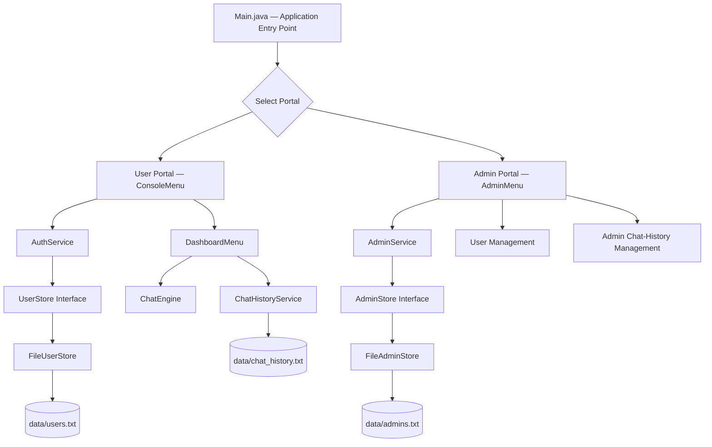
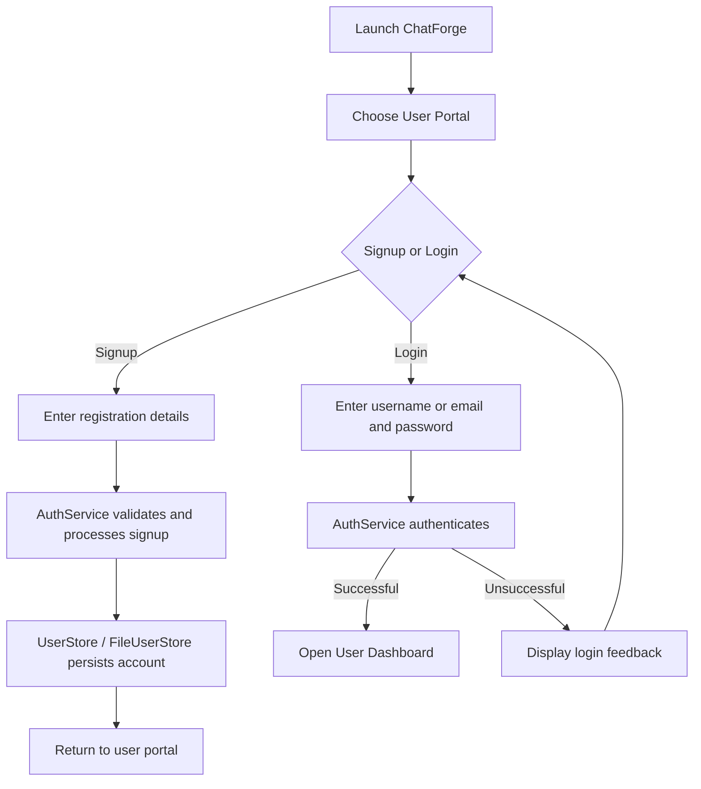
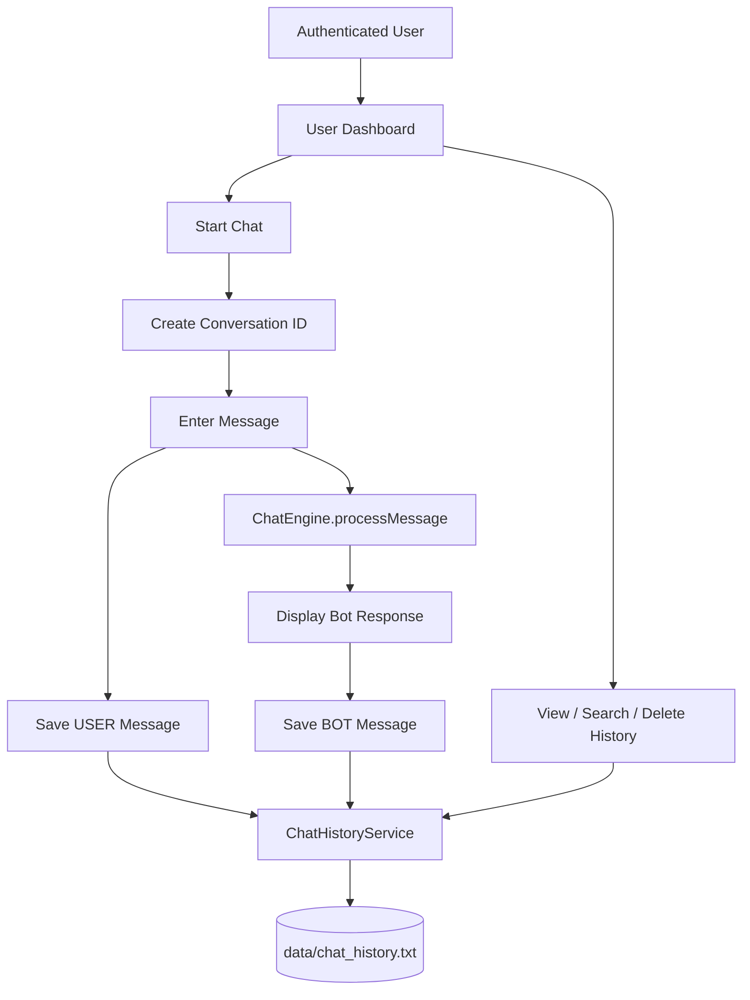
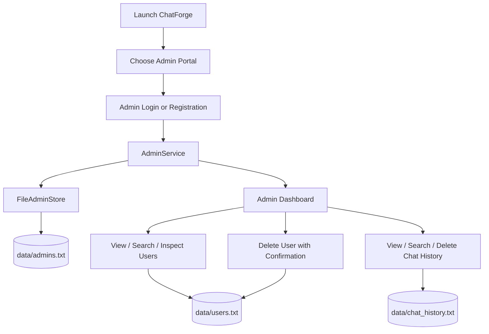

# ChatForge — Console-Based Java Chatbot Application

<p align="center">
  <strong>A modular, file-persisted chatbot application built with Core Java and Object-Oriented Programming.</strong>
</p>

<p align="center">
  
  
  
  
  
</p>

---

## Table of Contents

- [Project Overview](#project-overview)
- [Problem Statement](#problem-statement)
- [Purpose and Objectives](#purpose-and-objectives)
- [Target Users and Value](#target-users-and-value)
- [Application Scope](#application-scope)
- [Architecture](#architecture)
- [Modules and Features](#modules-and-features)
- [Application Workflows](#application-workflows)
- [Technology Stack](#technology-stack)
- [Repository Structure](#repository-structure)
- [Object-Oriented Design](#object-oriented-design)
- [Persistence and Data Management](#persistence-and-data-management)
- [Authentication and Security Notes](#authentication-and-security-notes)
- [Development Methodology](#development-methodology)
- [Engineering Decisions and Trade-offs](#engineering-decisions-and-trade-offs)
- [Testing and Validation](#testing-and-validation)
- [Setup and Execution in Eclipse](#setup-and-execution-in-eclipse)
- [Usage Guide](#usage-guide)
- [Limitations](#limitations)
- [Future Enhancements](#future-enhancements)
- [Project Outcomes](#project-outcomes)
- [Author](#author)

---

## Project Overview

**ChatForge** is a Java console-based chatbot application that demonstrates how a command-driven application can be organized using Object-Oriented Programming (OOP), modular packages, interfaces, service classes, and file-based persistence.

The application provides separate user and administrator portals. Users can register and authenticate, interact with the chatbot, and manage their conversation history. Administrators can manage user records and review or manage stored chat history.

ChatForge is intentionally implemented as a **Core Java / console application**. It does not use Spring Boot, Hibernate, a relational database, a web frontend, or an external AI/LLM API. Application data is persisted using local files.

### At a glance

| Item | Details |
|---|---|
| Project | ChatForge |
| Application type | Console-based Java application |
| Language | Core Java |
| IDE | Eclipse IDE |
| Architecture | Modular, package-based application |
| Persistence | Local file storage |
| User access | User portal and administrator portal |
| Main capabilities | Registration, login, chatbot interaction, conversation history, admin user and history management |
| External AI integration | Not included in the current implementation |

## Problem Statement

A basic chatbot demonstration often focuses only on receiving a message and printing a response. That approach does not demonstrate the broader application concerns found in software systems, such as account registration, authentication, persistent records, role-specific access, conversation management, and administrative operations.

ChatForge addresses this learning and application-design problem by bringing these capabilities into one structured console application. It provides a practical example of how Core Java can be used to build a multi-module program with clear responsibilities and persistent data—without depending on a database or framework.

## Purpose and Objectives

The project was developed to:

- Apply OOP principles in a complete Java application.
- Separate application responsibilities into packages and classes.
- Implement user and administrator registration and login.
- Process user messages through a chatbot engine.
- Save conversation messages so they can be reviewed later.
- Support history viewing, keyword search, and conversation deletion.
- Provide administrative user-management and chat-history operations.
- Practice Java interfaces, service classes, constructors, collections, exception handling, and file I/O.
- Build and run the application in Eclipse IDE.

## Target Users and Value

### End users
Users who want to create an account, use the console chatbot, and access their previous conversations.

### Administrators
Administrators who need to review registered users and manage stored user or conversation records through an administrative menu.

### Learning and engineering value
ChatForge is also a practical learning project for students and early-career developers studying Java application structure, OOP, authentication fundamentals, file handling, and modular design.

---

## Application Scope

The current application includes:

- Console-based navigation
- User registration and login
- Administrator registration and login
- Chatbot message processing
- Conversation creation and unique conversation identifiers
- Persistent user, administrator, and chat-history records
- User-specific chat-history viewing and searching
- Conversation deletion
- Admin user listing, searching, viewing, and deletion
- Admin chat-history review, search, and deletion

The current scope does **not** include web pages, REST APIs, SQL/NoSQL databases, Spring, Hibernate, PDF upload or analysis, quiz generation, study planning, or third-party AI integrations.

---

## Architecture

ChatForge uses a modular, package-based structure. The entry point initializes the application components and routes the user to the selected portal. UI/menu classes handle console interaction, service classes coordinate operations, interfaces define storage contracts, and file-store implementations persist records.

### High-level architecture



### Module responsibilities

| Module / Component | Responsibility |
|---|---|
| `main` | Starts the application and initializes dependencies |
| `auth` | User authentication and user-store contract/implementation |
| `admin` | Administrator model, authentication/service logic, and admin-store contract/implementation |
| `core` | Processes chatbot messages and produces responses |
| `ui` | Console menus, user dashboard, and administrator dashboard |
| `history` | Creates, saves, retrieves, searches, and deletes conversation records |
| `data` | Local files used for persistent application records |

### Interaction pattern

1. `Main` initializes the required storage and service objects.
2. The console UI receives user input and displays menus.
3. UI classes delegate authentication and data operations to service classes.
4. Services use store interfaces to access persisted account data.
5. The user dashboard sends chat input to `ChatEngine`.
6. The dashboard passes both user messages and chatbot responses to `ChatHistoryService`.
7. The history service writes and reads records from the local history file.
8. The admin dashboard uses service and file-backed operations to review and manage user and chat data.

---

## Modules and Features

### 1. Main application and portal selection

**Purpose:** Provide the application entry point and direct users to the appropriate portal.

- Starts the application.
- Initializes required dependencies.
- Presents portal choices.
- Routes to the user portal or administrator portal.

**Primary class:** `main/Main.java`

### 2. User registration and authentication

**Purpose:** Allow a user to create an account and access the application.

- User signup with account details such as name, username, and email.
- User login using username or email with a password.
- Authentication handled through `AuthService`.
- User data managed through the `UserStore` contract and `FileUserStore` implementation.

**Primary components:** `ConsoleMenu`, `AuthService`, `UserStore`, `FileUserStore`, `User`

### 3. Chatbot interaction

**Purpose:** Provide a console-based conversational experience.

- Starts a conversation for the logged-in user.
- Receives user input through the console.
- Sends the input to `ChatEngine`.
- Displays the returned response.
- Continues the chat loop until the user exits the chat flow.
- Records both user and bot messages.

**Primary components:** `DashboardMenu`, `ChatEngine`

> ChatForge's current chatbot processing is implemented within the Java application. An external generative AI model or hosted LLM is not configured in this version.

### 4. Conversation history management

**Purpose:** Make conversations persistent and accessible after a chat session.

- Generates a conversation identifier.
- Stores conversation metadata and messages.
- Stores both `USER` and `BOT` message records.
- Retrieves the logged-in user's history.
- Searches conversation messages using a keyword.
- Deletes a selected conversation using the username and conversation ID.
- Appends new records and rewrites remaining records when deletions are performed.

**Primary component:** `history/ChatHistoryService.java`

### 5. Administrator registration and authentication

**Purpose:** Provide a separate administrator access path.

- Administrator account model and service.
- Admin registration and login operations.
- File-backed admin records.
- Separate administrator menu and dashboard.

**Primary components:** `Admin`, `AdminService`, `AdminStore`, `FileAdminStore`, `AdminMenu`

### 6. Administrator dashboard

The administrator dashboard includes the following operations:

| Option | Capability | Description |
|---:|---|---|
| 1 | View all users | Display registered user records |
| 2 | Search users | Locate users |
| 3 | View user details | Display details for a selected user |
| 4 | Delete user | Delete a user record after confirmation |
| 5 | View all chat history | Review stored conversations |
| 6 | Search user chat history | Search chat records for a user |
| 7 | Delete user chat history | Remove chat history records |
| 8 | View admin profile | Display administrator profile information |
| 9 | Logout | Exit the admin dashboard |

**Primary component:** `ui/AdminMenu.java`

### 7. File-based persistence

**Purpose:** Persist application records without a database.

- User records are managed through `FileUserStore`.
- Admin records are managed through `FileAdminStore`.
- Chat records are managed through `ChatHistoryService`.
- Storage files are created or updated by the application’s file-handling logic.

---

## Application Workflows

### User registration and login



### Chat and history workflow



### Administrator workflow



### Authentication flow summary

1. The user or administrator selects the corresponding portal.
2. Console menus collect account credentials.
3. Authentication service performs the relevant signup or login operation.
4. File-store implementations provide persisted account data.
5. Successful authentication opens the corresponding dashboard.
6. The user can log out and return to portal navigation.

### Dashboard flow summary

The user dashboard provides options to start a chatbot session, view stored history, search history, delete a conversation, or log out. The administrator dashboard provides account and history management capabilities described above.

---

## Technology Stack

| Category | Technology | Usage |
|---|---|---|
| Programming language | Core Java | Application logic, OOP, menus, services, and data handling |
| Runtime / standard APIs | Java SE APIs | Collections, file I/O, time/date, UUID, encoding, and input handling |
| IDE | Eclipse IDE | Development, execution, and debugging |
| User interface | Java Console | Text-based menus and interaction |
| Persistence | Local file handling | User, admin, and chat-history records |
| Authentication | Java service logic | User and admin signup/login |
| Password hashing | PBKDF2 with salt | Password hashing in authentication services |
| Version control | Git | Local source control and branch management |
| Repository hosting | GitHub | Project source-code repository |

### Technologies intentionally not used

The current ChatForge implementation does not use:

- Spring Boot or Spring Framework
- Hibernate or JPA
- MySQL, PostgreSQL, MongoDB, or another database
- HTML, CSS, JavaScript, React, or a web frontend
- REST APIs
- External AI/ML or LLM services
- Cloud deployment platforms

This keeps the application focused on Core Java, OOP, console interaction, and file persistence.

---

## Repository Structure

The repository contains the Eclipse Java project under `AIChatbotFramework/`. The following structure describes the main modules and storage paths used by the application:

```text
ChatForge/
└── AIChatbotFramework/
    ├── .classpath
    ├── .project
    ├── .gitignore
    ├── .settings/
    │   └── org.eclipse.*.prefs
    ├── src/
    │   ├── admin/
    │   │   ├── Admin.java
    │   │   ├── AdminMenu.java
    │   │   ├── AdminService.java
    │   │   ├── AdminStore.java
    │   │   └── FileAdminStore.java
    │   ├── auth/
    │   │   ├── AuthService.java
    │   │   ├── FileUserStore.java
    │   │   ├── User.java
    │   │   └── UserStore.java
    │   ├── core/
    │   │   └── ChatEngine.java
    │   ├── history/
    │   │   └── ChatHistoryService.java
    │   ├── main/
    │   │   └── Main.java
    │   └── ui/
    │       ├── ConsoleMenu.java
    │       └── DashboardMenu.java
    └── data/
        ├── users.txt
        ├── admins.txt
        └── chat_history.txt
```

> This is a major-module overview. Eclipse metadata and additional source files may be present in the repository. The `data/` directory contains local application records; actual contents depend on the accounts and conversations created during execution.

### Package descriptions

| Package | Main responsibility |
|---|---|
| `admin` | Administrator model, service, storage contract, file-store implementation, and admin menu |
| `auth` | User model, authentication service, user-store contract, and file-store implementation |
| `core` | Chatbot message-processing logic |
| `history` | Conversation identifiers, message persistence, retrieval, searching, and deletion |
| `main` | Application startup and portal selection |
| `ui` | User registration/login menus and user dashboard |

---

## Object-Oriented Design

ChatForge uses several OOP and Java design concepts.

| Concept | Application of the concept |
|---|---|
| Classes and objects | Models such as `User` and `Admin`, along with service and menu classes |
| Encapsulation | Model data is encapsulated behind class-level access methods |
| Abstraction | Storage interfaces define contracts without exposing the concrete file-storage implementation to every caller |
| Interfaces | `UserStore` and `AdminStore` define storage contracts |
| Interface implementation | `FileUserStore` and `FileAdminStore` implement file-based storage |
| Constructors | Initialize models and service/menu dependencies |
| Constructor-based dependency injection | Dependencies are passed into classes that coordinate application behavior |
| Polymorphism | Storage implementations can be used through their interface contracts |
| Collections | Lists and maps organize loaded users and conversation records |
| Exception handling | `try-catch` and related handling support file and input operations |
| UUID | Generates unique identifiers for users or conversations where implemented |
| File I/O | Reads and writes persistent application records |

### Separation of responsibilities

- **Model classes** represent application data.
- **Service classes** coordinate business operations.
- **Store interfaces** define persistence contracts.
- **File-store classes** implement persistence using local files.
- **UI classes** handle console input, menus, and output.
- **Core chatbot class** processes chat messages.
- **History service** manages conversation records.

This organization makes the application easier to navigate and maintain than placing all logic in a single class.

---

## Persistence and Data Management

ChatForge uses local text files as its persistence layer.

| File | Purpose |
|---|---|
| `data/users.txt` | User account records |
| `data/admins.txt` | Administrator account records |
| `data/chat_history.txt` | Conversation metadata and message records |

### Chat-history record handling

The history service supports operations such as:

- Creating a conversation and returning a conversation ID
- Recording username, conversation ID, message role, time, and message content
- Retrieving conversation records for a user
- Searching message text using a keyword
- Deleting records associated with a specified user and conversation
- Appending records and rewriting the file after deletion

The implementation uses Java time APIs for timestamps and Base64 encoding/decoding for chat-message text representation in file records.

**Important:** Base64 is an encoding format, not encryption. It does not provide confidentiality for message content.

---

## Authentication and Security Notes

The authentication implementation includes password hashing using **PBKDF2 with salt** in the user/admin authentication services. This is a stronger approach than storing a raw password as plain text.

Security-related design elements include:

- Password hashing instead of direct plain-text password storage
- Separate user and administrator authentication paths
- User-specific conversation access and deletion parameters
- Confirmation before administrator user deletion
- Service and store separation to centralize account-related operations

### Security scope

ChatForge is an educational console application, not a production identity platform. A production deployment would require additional controls such as hardened secret management, authorization enforcement across every operation, rate limiting, audit logging, secure storage permissions, and stronger protection of stored chat data.

---

## Development Methodology

### Iterative development approach

The project can be described as an **iterative, incremental development workflow**. Features are built in manageable units, integrated with existing modules, and checked through execution in Eclipse.

> This section describes the development approach at a process level. Exact sprint dates, sprint counts, team size, and formal Agile ceremonies are not specified in the current project documentation and should only be added if they reflect the actual project history.

### Agile-inspired workflow

| Activity | How it applies to ChatForge |
|---|---|
| Requirement identification | Identify the necessary user portal, admin portal, chatbot, and history capabilities |
| Work breakdown | Separate requirements into authentication, storage, UI, chatbot, and history modules |
| Iterative implementation | Implement and integrate one module or feature at a time |
| Integration | Connect menu classes to services and storage implementations |
| Validation | Run the application in Eclipse and verify expected console behavior |
| Feedback and refinement | Review menu behavior, record handling, and feature usability; adjust implementation as needed |
| Incremental delivery | Keep the application in a runnable state as features are added |

### Example feature increments

1. Application startup and portal navigation
2. User and administrator models
3. User/admin authentication and file stores
4. Chat engine and user dashboard
5. Conversation persistence and history actions
6. Administrator user-management and history-management operations
7. Integration, debugging, and repository documentation

### Challenges and learning areas

The project provides practice in:

- Managing persistent records without a database
- Coordinating UI, service, and storage responsibilities
- Handling file reads, writes, and record deletion
- Keeping user-specific history operations scoped to the appropriate account
- Integrating multiple modules while maintaining a runnable console application

---

## Engineering Decisions and Trade-offs

### Why Core Java?

**Decision:** Use Core Java and standard Java APIs.

**Rationale:** The project’s objective is to demonstrate Java fundamentals, OOP, modular design, and file handling without hiding application logic behind frameworks.

**Trade-off:** The developer must implement console navigation, persistence, validation, and service coordination directly.

### Why file-based persistence?

**Decision:** Use local files instead of a database.

**Rationale:** File handling is lightweight, easy to configure in a student project, and directly demonstrates Java I/O.

**Trade-offs and limitations:**

- File records do not provide database transactions.
- Concurrent access and consistency require additional design.
- Searching and rewriting large files can become inefficient.
- Data structure and schema changes require careful file-format handling.
- Local files are not suitable for multi-instance distributed deployment without a more robust persistence strategy.

### Why interfaces for stores?

**Decision:** Define storage contracts such as `UserStore` and `AdminStore`, with file-store implementations.

**Rationale:** Service code can depend on an abstraction rather than directly on a particular storage implementation. This supports clearer separation of responsibilities and makes a future persistence replacement easier to plan.

### Performance considerations

The current application is intended for local, small-scale use. Potential improvement areas include:

- Avoid repeatedly reading entire files for frequent operations.
- Introduce indexes or a database if record volume grows.
- Consider buffered I/O and a structured serialization format.
- Avoid unnecessary full-file rewrites where a scalable storage system is appropriate.

### Scalability considerations

A console application backed by local files is suitable for demonstrating application logic and persistence. Scaling to multiple users, concurrent sessions, or remote access would require a server architecture, shared storage, stronger transaction handling, and a more complete authorization model.

---

## Testing and Validation

The application is intended to be validated through execution and manual checks in Eclipse. The following checklist can be used to verify the principal flows.

| Area | Validation scenarios |
|---|---|
| Application startup | Launch from `Main.java`; verify portal menu is displayed |
| User registration | Register a user; verify account data is persisted |
| User login | Test valid and invalid credentials |
| Admin registration/login | Verify admin portal account operations |
| Chat interaction | Enter a message; verify a chatbot response is displayed |
| Conversation persistence | Verify user and bot messages are saved |
| History viewing | Verify the logged-in user's conversation records are displayed |
| History search | Search using a keyword present in a stored message |
| Conversation deletion | Delete a conversation and verify it no longer appears |
| Admin user operations | View, search, inspect, and delete user records with confirmation |
| Admin history operations | Review, search, and delete chat-history records |
| File handling | Verify the application handles expected file creation and read/write behavior |
| Console input | Exercise menu selections and unexpected input paths |

### Testing scope note

This is a console-based Java application. Browser compatibility, responsive UI checks, frontend form validation, and web performance tests are **not applicable** to the current implementation. No automated test framework or measured performance benchmark is claimed in this README.

---

## Setup and Execution in Eclipse

### Prerequisites

- Java Development Kit (JDK) compatible with the project’s configured Java version
- Eclipse IDE
- Git (optional, for cloning the repository)

### Clone the repository

```bash
git clone https://github.com/VARA4u-tech/ChatForge.git
```

### Import into Eclipse

1. Open Eclipse IDE.
2. Select **File → Import**.
3. Choose **General → Existing Projects into Workspace**.
4. Select the cloned repository directory.
5. Import the `AIChatbotFramework` project.
6. Confirm the project is recognized as a Java project.
7. Open `src/main/Main.java`.
8. Right-click the file and select **Run As → Java Application**.

### Run directly from an existing Eclipse workspace

1. Open the ChatForge project in Package Explorer.
2. Locate `main/Main.java`.
3. Right-click `Main.java`.
4. Choose **Run As → Java Application**.
5. Interact with the application through the Eclipse Console view.

### Data directory

The application uses the `data/` directory for local persistence. Ensure the application can access the directory from its working directory. The application’s file-handling logic may create required files when needed.

---

## Usage Guide

### User

1. Launch the application.
2. Choose the User Portal.
3. Register an account or log in.
4. Open the user dashboard.
5. Start a chat and enter messages.
6. View, search, or delete saved conversations.
7. Log out to return to the portal menu.

### Administrator

1. Launch the application.
2. Choose the Admin Portal.
3. Register or log in as an administrator.
4. Open the admin dashboard.
5. View, search, or inspect registered users.
6. Delete a user after confirmation when required.
7. View, search, or delete chat-history records.
8. View the admin profile or log out.

---

## Limitations

The current version has the following scope limitations:

- Console-only interface; no web or mobile UI.
- Local file-based persistence; no SQL or NoSQL database.
- Chatbot logic is application-local; no external LLM or AI API integration.
- Designed for local, small-scale execution rather than concurrent multi-user hosting.
- No cloud deployment or REST API.
- File storage has limited query, concurrency, transaction, and scaling capabilities.
- Automated testing and quantified performance results are not documented here.

These limitations are appropriate to the project’s focus on Core Java and OOP. They also provide clear directions for future development.

---

## Future Enhancements

Potential enhancements include:

### Application and interface
- Develop a graphical interface or web-based client.
- Improve console input validation and user experience.
- Add configurable chatbot commands and response capabilities.

### Persistence
- Replace text-file persistence with a relational database such as MySQL or PostgreSQL.
- Introduce structured data access and transaction handling.
- Add migration support for existing file records.

### AI integration
- Integrate an external LLM API behind a dedicated chatbot service abstraction.
- Add configurable model/provider support and controlled error handling.
- Clearly distinguish generated responses from built-in command-based responses.

### Security and administration
- Strengthen authorization checks for administrative operations.
- Add audit logs for administrative actions.
- Improve data protection and secure configuration handling.

### Quality and delivery
- Add unit and integration tests.
- Configure automated build and test workflows.
- Add application screenshots or console demonstrations.
- Provide packaged releases and setup instructions.

---

## Project Outcomes

ChatForge demonstrates the application of Core Java and OOP principles in a multi-module console application. It brings together:

- Modular package organization
- User and administrator account workflows
- Service and interface-based separation
- File-based persistence
- Chatbot interaction
- Conversation history operations
- Administrative user and history management
- Git and GitHub version control

The project is a foundation for further learning in Java application design, persistence, testing, and security-aware development.

## Author

**P. Durga Vara Prasad**

- GitHub: [VARA4u-tech](https://github.com/VARA4u-tech)
- Project Repository: [ChatForge](https://github.com/VARA4u-tech/ChatForge)

---

<p align="center">
  <strong>ChatForge — Building practical Java applications through modular design and OOP.</strong>
</p>
